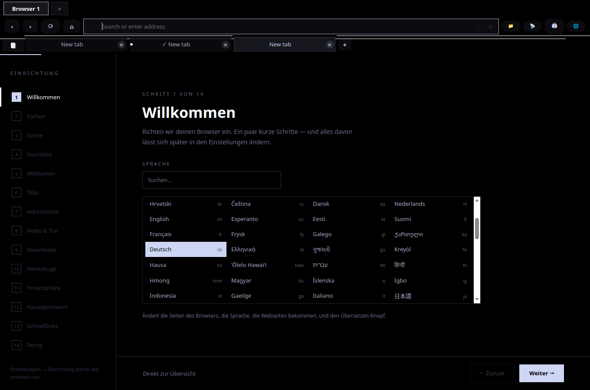
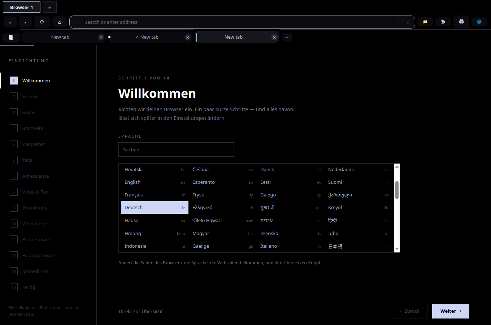
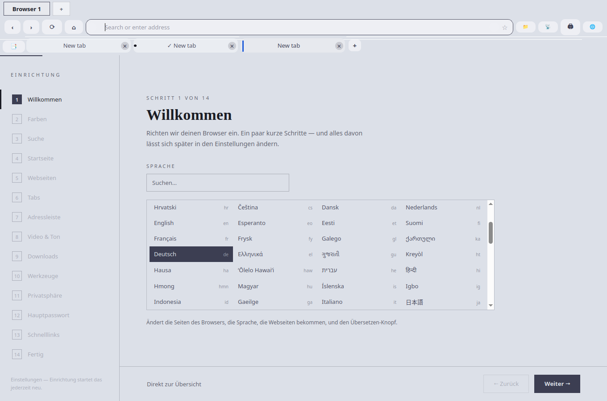
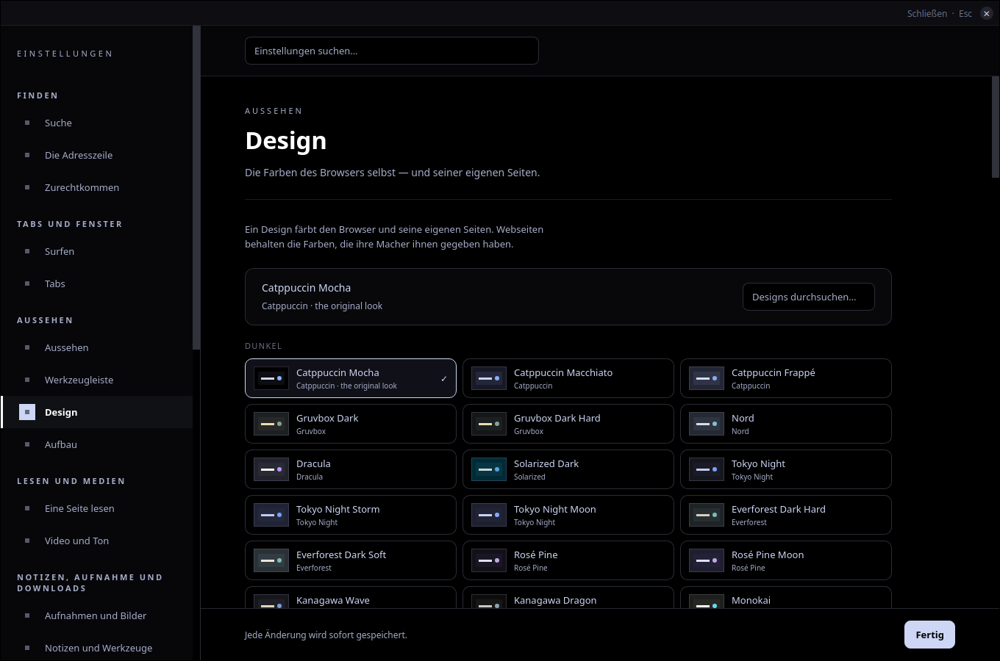

# Themes that keep every website readable

2026-11-07. Fifty-four real sites, every one of the 116 themes, measured in the page
and looked at. Started from "Outlook is unreadable in some theme".

## What was wrong, in one paragraph

Not Outlook, and not a theme: the site theming pass fought itself. Every site element
eased between colours over .35 s, and the pass reads an element's colours back right
after it writes them, so what it recorded as "my own work" was the colour the element
was fading *from*. Every later look took the finished colour for the site's doing,
restored the element, judged a mid-fade grey, wrote again, and the observer saw the
write. On a page that keeps mutating (the Outlook landing page, office.com, the
Microsoft sign-in page) that loop never ended: the main thread stayed busy, text was
judged against colours that were never on screen, and a theme switched while the page
was open left the *last* theme's observer alive with the last theme's palette, repainting
the new theme's cards in the old theme's dark. The sign-in card in Latte after Mocha was
exactly that: a Mocha-dark card with Latte-dark text on it.

## Root causes fixed (theme_web.py)

| # | Cause | Fix |
|---|---|---|
| 1 | A live re-theme ran the script again in a page the last run was still watching; both runs saw each other's writes as "the site moved" and repainted each other for as long as the tab was open | One run at a time: a run switches the previous observer off and every leftover slice/timer of the old run checks it is still current |
| 2 | `.35s` colour transition on every site element: the read-back after a write recorded the *start* colour, so every later look thought the site had restyled the element | No transition on sites (the chrome switches in one frame too); the record of "what I wrote" is composed from the written values, and an element mid-way through the *site's own* fade is waited out, not judged |
| 3 | The staleness check compared an element's `color` even when it shows no text; the inherited colour changes when an ancestor is painted, so every card on a page "moved" at every look | Only what an element shows is compared: its fill, its text colour if it has text, its border colour if it has a border |
| 4 | On a re-theme every painted element was restored and then read back one by one: a full style recalculation per element, a minute of main thread on a 16000-element page | Restores are batched per chunk and read after one recalculation (1.7 s for 16000 elements in the test) |
| 5 | Full re-looks were capped at four per page; a stylesheet chunk landing later (office.com's cards, hydrated section by section) was never seen, and the text painted for a white card stayed theme-light on it | Looks are rate-limited (one per 1.5 s), not counted out; a look is also taken at 6 s, 15 s and on scroll |
| 6 | A headline over a *sibling* picture (Outlook's hero `` positioned under the words) looked like text on the page background and was repainted in the theme's light text — invisible on the light photo | On screen the stack under the text is asked (`elementsFromPoint`): a picture beneath means "leave it", an opaque layer beneath is the real backdrop. Asked once per decision, not at every look |
| 7 | Links and headings were always given the accent, even when they already read; a wrong guess about the background then cost a headline that was fine | Text that already reads is kept, links and headings included; the accent comes only when the site's colour no longer reads on the fill the pass made |
| 8 | A placeholder was coloured `overlay` by a global rule (under 4.5:1 on a card on 115 of 116 palettes), and a field left transparent on a repainted card kept the site's placeholder (Microsoft's: black at 60 % on near-black) | The placeholder is measured against what is really behind the field like any text, and only when it fails the field gets one of four classes: `dim` (the quietest token that clears 4.5:1 on every surface of all 116 palettes), the text colour, white or black |
| 9 | An element measured while empty (Microsoft's "Sign in" heading is filled by a script) was recorded as "nothing moved" when its words arrived, so it stayed the site's dark on the dark card | The record says whether the element had words; one that gets them later is looked at again |
| 10 | A site script that rewrites an element's style attribute was answered on every frame | Capped at five restores per element; the pass gives an element up after six restore/repaint rounds (a theme switch does not count as a round) |
| 11 | **The one only the signed-in views showed.** Outlook's panels carry `transition: all .2s`. On a theme switch the pass restores a panel and waits for its fade, but the dates *inside* were judged at once, against the dark the panel was fading from, and painted white; the panel itself then needed no repaint, so nothing ever came back to them. Mini-calendar dates and the People headers invisible in 114 of 116 themes, worse with every switch; Gmail's lower rows the same | An element waiting out its fade is marked pending — after a restore, after the pass's own write to it, and while its fill is visibly between colours in a fade the *site* started — and anything that sits on it (ancestors or a layer underneath) is "unsure" and is judged after it settles. A re-theme also looks back over the page at 1.5 s and 4 s |
| 12 | When the pass gave an element up (six rounds of disagreeing with a script that restyles it every frame) it left it half-done: the pass's fill under the site's ink | Giving up restores the element to the site's colours entirely |

Counters for all of this live in `window.__stStats` (ApplicationWorld): slices, measured,
painted, full looks, observer callbacks, flips, waits, reputs, time per phase, and the first
24 reasons an element was looked at again. `_sitediag.py URL THEME SELECTOR` prints them
with the ancestor chain of any element.

## Per-site exceptions

None added. Every fix above is a general rule; `NATIVE_DARK_SITES` is unchanged.

## The chrome (browser.py `STYLE`, settings.html, start.html)

Calmer, flatter, rounder, after the two reference screenshots (a timetable app's white
cards on soft grey with one thin accent bar; a home screen's big rounded widgets on black):

- address bar: 12 px radius, no hairline until it has focus
- tabs: 10 px radius, more room; the selected tab is no longer boxed in a hairline — it
  carries one thin accent bar down its left edge instead (painted in `GroupTabBar._extras`,
  pair added to `test_paintcontrast.py`); the sidebar's current row is a flat pill
- menus 12 px with 8 px items; every floating panel (find, toast, permission card, account
  chooser, share picker, favourites, start menu, tab switcher) 14 px; their hairlines at
  about half the alpha; buttons and fields in them 8–10 px
- settings and start page: cards, rows, option cards, fields, buttons and the switches
  rounded (12/10 px), the switch a pill; grouped rows share one rounded outline
- palettes: colours unchanged. The 116 palettes are credited and the contrast ladder is
  measured; the calm comes from geometry and fewer lines, not from new colours.

| before | after |
|---|---|
|  |  |
|  |  |
|  |  |

Flat mono still squares everything (its own sheet wins), and the corner-radius setting
still overrides all of it.

## How it was measured

`_sitematrix.py` boots the real browser offscreen, loads a site once and applies every
theme to it live (the Settings > Theme path), or loads it afresh per theme (the first-visit
path); `_siteaudit.js` then measures, in the page, every element that shows text: the
colour it is really drawn in (text-fill colour, alpha, opacity up the tree) against what
is really behind it (opaque ancestors blended, the stack under the text on screen, a
photo or gradient = "cannot be judged"), weighted by characters. A cell is the share of
judged text under 3:1 — unreadable, not merely weak. `f` marks a form field or
placeholder that fails, `i` marks text whose box in the screenshot is a flat patch of
one colour (invisible whatever the styles say), `busy` a page whose main thread did not
answer in 9 s twice. `theme-audit/drive.sh <out> before|after` runs it one site per
memory-capped process (`theme-audit/capped.sh`), two at a time.

MATRIX_BEFORE

MATRIX_AFTER

## Signed in: Outlook mail, calendar, people, Gmail, YouTube, GMX

SIGNED_IN

## Still broken, or left alone on purpose

STILL_BROKEN

## Tests

- `test_sitetheme_rules.py` (new): one page per root cause above, 30 checks in 9
  sections. Against the old module (`theme-audit/check/rules_on_head.py` runs the suite
  with git HEAD's `theme_web.py`) 15 of them are red, in 7 of the 9 sections; the
  placeholder and big-page sections pin rules whose real-page failures the synthetic
  page does not reproduce on the old code. `test_sitetheme_render.py`, `test_contrast.py`, `test_paintcontrast.py`,
  `test_theme.py`, `test_looks.py`, `test_look2.py`, `test_themefix.py`,
  `test_themetokens.py`, `test_offpalette.py`, `test_palette.py`: green.

## What to port to the Windows, macOS and Android editions

- **theme_web.py, all of it** (Windows and macOS carry the same module): every row in the
  table above is in `SITE_JS` and `_base_css`. The transition removal matters most; the
  rest comes with it. `test_sitetheme_rules.py` and `_siteaudit.js` go with it.
- **Android** has its own painter: the rules to carry over are 2 (never read back a
  colour during a transition; record what you wrote), 3 (compare only what the element
  shows), 6 (ask what is painted under the text, not only the ancestors), 7 (keep what
  reads), 8 (the placeholder measured like text, `dim` first), 9 (an element that gets
  text later is looked at again), 1 (one run at a time).
- **STYLE / settings.html / start.html**: the rounded geometry is pure QSS/CSS and ports
  as-is; the accent bar is three lines in the tab painter. The pages are shared through
  `~/claude/browser-pages`; they call no new bridge method.
